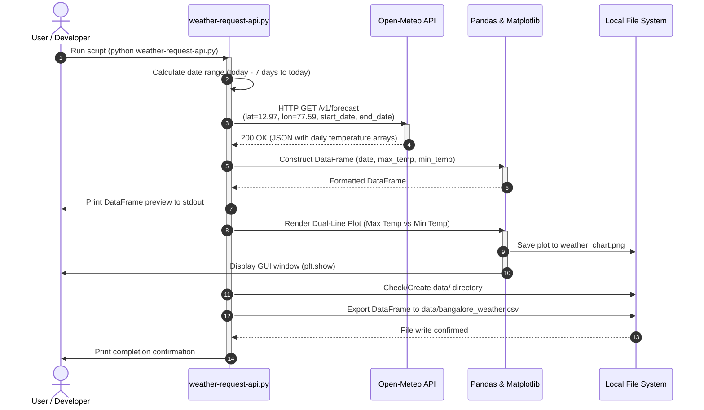

# Weather Week Data Aggregator

[](https://www.python.org/)
[](https://open-meteo.com/)
[](https://pandas.pydata.org/)
[](https://matplotlib.org/)

A lightweight Python data pipeline that aggregates the past 7 days of daily maximum and minimum temperature records for Bangalore (or any target location) using the [Open-Meteo API](https://open-meteo.com/). The script automatically cleans and transforms the data with **Pandas**, visualizes temperature trends with **Matplotlib**, and saves the results to both an image chart and a CSV dataset.

---

## Features

- **Zero API Key Required:** Connects directly to the Open-Meteo public weather forecast and historical API without sign-ups or credentials.
- **Dynamic Date Window:** Dynamically computes a rolling 7-day date window relative to execution time (`today - 7 days`).
- **Data Transformation:** Converts nested JSON metrics into a structured [Pandas](https://pandas.pydata.org/) DataFrame with formatted datetime timestamps.
- **Visual Analytics:** Generates a dual-line plot (`weather_chart.png`) contrasting maximum and minimum temperatures across the week.
- **Automated Data Persistence:** Ensures output directories exist and writes tabular records to `data/bangalore_weather.csv`.

---

## System Sequence Diagram

The following sequence diagram illustrates the complete end-to-end flow of data retrieval, processing, plotting, and file export:



---

## Repository Structure

```text
weather-week-data-aggregator/
│
├── data/
│   └── bangalore_weather.csv    # Aggregated 7-day historical weather CSV
│
├── weather-request-api.py       # Core execution script (API fetch, plot, export)
├── weather_chart.png            # Generated temperature trend graph
├── requirements.txt             # Python dependencies
├── .gitignore                   # Ignored files (virtualenv, caches, logs)
└── README.md                    # Project documentation
```

---

## Getting Started

### Prerequisites

Ensure you have **Python 3.10+** installed on your system.

### 1. Clone the Repository

```bash
git clone https://github.com/joshxdevs/weather-week-data-aggregator.git
cd weather-week-data-aggregator
```

### 2. Create and Activate a Virtual Environment

- **macOS / Linux:**
  ```bash
  python3 -m venv .venv
  source .venv/bin/activate
  ```
- **Windows:**
  ```powershell
  python -m venv .venv
  .venv\Scripts\activate
  ```

### 3. Install Dependencies

```bash
pip install -r requirements.txt
```

---
